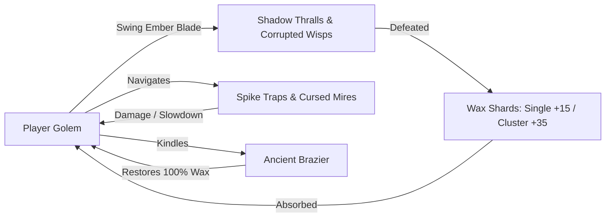
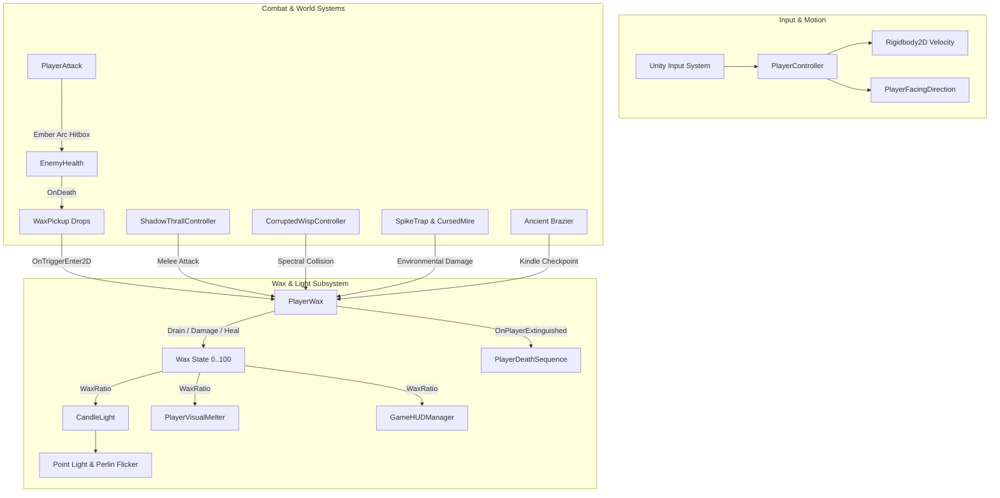

<div align="center">
  

  <p>
    <a href="https://unity.com/"></a>
    <a href="https://learn.microsoft.com/en-us/dotnet/csharp/"></a>
    
    
    <a href="LICENSE"></a>
    
  </p>

  **What if your health bar was the only thing keeping the darkness away?**

  <p>
    🕯️ Explore an oppressive gothic dungeon as a fragile candle golem whose molten wax is both health and light ⚔️
  </p>

  <p>
    <a href="#-game-overview">Overview</a> •
    <a href="#-core-mechanics">Core Mechanics</a> •
    <a href="#-controls">Controls</a> •
    <a href="#-architecture">Architecture</a> •
    <a href="#-dungeon-threats-and-interactables">Dungeon Threats</a> •
    <a href="#-getting-started">Getting Started</a> •
    <a href="#-project-specification-compliance">Deliverables</a>
  </p>
</div>

<div align="center">

| System | Specification | Status |
|:---|:---|:---:|
| 🎮 **Engine** | Unity 6 (6000.3.8f1) with 2D Point Filtering | Operational |
| 🕯️ **Wax Mechanics** | Dual-resource health pool, passive decay, and light tether | Operational |
| 🗡️ **Combat** | 4-directional ember blade, lunge impulses, knockback | Operational |
| 👁️ **Visibility** | Dynamic radial point light, Perlin flame flicker, Darkness Shroud | Operational |
| 🧪 **Verification** | 100% verified core gameplay math (`tests/test_core_mechanics.py`) | Operational |

</div>

---

## 📖 Table of Contents

- [Overview](#-game-overview)
- [The Premise](#-the-premise)
- [Core Mechanics](#-core-mechanics)
- [Controls](#-controls)
- [Dungeon Threats and Interactables](#-dungeon-threats-and-interactables)
- [Architecture](#-architecture)
- [Project Structure](#-project-structure)
- [Getting Started](#-getting-started)
- [Project Specification Compliance](#-project-specification-compliance)
- [Contributing](#-contributing)
- [License](#-license)

---

## 🕯️ Game Overview

**WickFall** is a top-down 2D Action RPG built in Unity 6. You awaken as a fragile candle golem inside an ancient, decaying crypt. Molten wax runs through your form: it sustains your life, fuels your flame, and illuminates the pitch-black corridors around you.

<div align="center">
  
  <p><em>The decaying subterranean crypts of WickFall, shrouded in oppressive darkness.</em></p>
</div>

When enemies strike or when time slips by, your wax depletes. As your wax shrinks, your circle of light dims, pulling the dungeon's horrors closer and shrouding lethal spike pits in darkness. To survive, you must master ember blade combat, harvest wax shards from fallen adversaries, and rekindle the sacred Braziers to secure your passage.

<div align="center">

| Full Wax (100%) | Ember Strike Attack | Low Wax State (<25%) | Sacred Brazier Rest |
|:---:|:---:|:---:|:---:|
|  |  |  |  |
| **Radiant Flame**<br>8.0m light radius<br>Maximum mobility | **Ember Blade**<br>25 melee damage<br>2.5 lunge impulse | **Melting Form**<br>2.0m light radius<br>Erratic flame flicker | **Sanctuary**<br>100% wax restored<br>Darkness banished |

</div>

---

## ⚡ The Premise

* **The Problem:** In conventional action RPGs, health bars and environmental vision are isolated systems. Taking damage rarely impacts how you perceive the space around you.
* **The Solution:** WickFall unifies health, stamina, and vision into a single physical resource: **Molten Wax**. Taking a hit doesn't just reduce a meter: it immediately contracts your sight radius down to your feet, plunging you into near-total darkness.
* **The Result:** High-stakes exploration where risk assessment is immediate and tactile. Navigating dark corners requires maintaining your wax through precise combat and timely resource collection.

---

## ⚙️ Core Mechanics

### 1. Dual-Resource Wax System (`PlayerWax.cs`)
* **Maximum Wax:** 100 units.
* **Passive Consumption:** Continual gentle burn rate drains wax gradually over time.
* **Direct Damage:** Traps and enemy melee strikes inflict immediate wax loss, triggering invulnerability frames (`0.5s`) and directional knockback.
* **Visual Melting:** An 8-stage candle indicator on the HUD tracks wax depletion in real-time alongside character sprite damage flashes.

### 2. Dynamic Flame & Darkness Shroud (`CandleLight.cs`, `DarknessShroud.cs`)
* **Light Radius Scaling:** Lerps smoothly between `8.0m` (at 100% wax) and `2.0m` (at near-extinction).
* **Light Intensity:** Adjusts from `1.5` down to `0.4` with organic Perlin noise flicker (`flickerSpeed: 10f`).
* **Darkness Shroud:** A dynamic fog-of-war vignette tracking the player's position, masking corridors outside the candle flame's influence.

### 3. Directional Combat & Mobility (`PlayerController.cs`, `PlayerAttack.cs`)
* **4-Way Dominant Axis:** Precision movement across North, South, East, and West with zero diagonal sliding ambiguity.
* **Ember Strike:** 25 damage melee arc positioned according to facing direction (`hitRadius: 0.75m`, `attackOffset: 1.0m`).
* **Lunge Impulse:** Each swing imparts a `2.5` impulse burst, enabling skilled players to lunge out of slowing hazards.

---

## 🎮 Controls

WickFall features full support for modern keyboards and gamepads via the Unity Input System.

| Action | Keyboard / Mouse | Gamepad | Description |
|:---|:---|:---|:---|
| **Move North** | `W` or `Up Arrow` | Left Stick Up / D-Pad Up | Walk north with back-facing walk frames |
| **Move South** | `S` or `Down Arrow` | Left Stick Down / D-Pad Down | Walk south facing camera |
| **Move West** | `A` or `Left Arrow` | Left Stick Left / D-Pad Left | Walk west with mirrored side sprites |
| **Move East** | `D` or `Right Arrow` | Left Stick Right / D-Pad Right | Walk east with side sprites |
| **Ember Strike** | `Space` / `J` / `Left Click` | West Button (`X` Xbox / `□` PS) | Swing blade, dealing 25 damage with lunge |
| **Kindle / Interact** | Walk into range | Walk into range | Rest at Brazier or collect Wax Shards |
| **Pause / Options** | `Escape` | `Start` / `Options` | Open settings, pause game, or exit |

---

## 👹 Dungeon Threats and Interactables

<div align="center">

| Shadow Thrall | Corrupted Wisp | Wax Shard Cluster | Ancient Brazier |
|:---:|:---:|:---:|:---:|
|  |  |  |  |
| **Melee Predator**<br>Detection pursuit & claw swipe | **Spectral Disruptor**<br>Phases through walls & dims flame | **Vital Resource**<br>Restores +35 molten wax | **Checkpoint Shrine**<br>Rekindles & restores 100% wax |

</div>



### Adversaries
* **Shadow Thralls (`ShadowThrallController.cs`):** Aggressive subterranean stalkers. They patrol until the candle golem enters their detection radius, sprint to intercept, telegraph with a brief windup, and unleash melee claw swipes.
* **Corrupted Wisps (`CorruptedWispController.cs`):** Erratic spectral entities that hover through crypt walls, distorting the player's flame and inflicting contact damage.

### Environmental Hazards
* **Spike Traps (`SpikeTrap.cs`):** Retractable wrought-iron floor spikes cycling through Safe, Warning, and Active phases.
* **Cursed Mires (`CursedMire.cs`):** Viscous puddles that reduce player movement speed to 60% and steadily leach wax. An attack lunge can be used to escape.

### Restoration & Shrines
* **Wax Pickups (`WaxPickup.cs`):** Single shards restore +15 wax, while dense wax clusters restore +35 wax.
* **The Ancient Brazier (`Brazier.cs`):** Sacred stone altars. Rekindling an unlit brazier triggers celebratory flares, permanently illuminates the room, and refills the golem's wax reserves to 100%.

---

## 🏗️ Architecture

The codebase separates concerns between core gameplay entities, environmental hazards, visual feedback loops, and automated editor tooling.



---

## 📁 Project Structure

```
WickFall/
├── Assets/
│   ├── Audio/               # Crypt ambient loops, swings, impacts, UI SFX
│   ├── Documentation/       # Art Direction Brief and Technical Specifications
│   ├── Editor/              # Scene builders, atlas generator, self-checks
│   │   ├── GameSceneBuilder.cs       # Level layout and object assembly
│   │   ├── MainMenuBuilder.cs        # UI scene generation
│   │   └── CoreMechanicsSelfCheck.cs # In-Editor regression runner
│   ├── Fonts/               # Medieval gothic font assets
│   ├── Scenes/
│   │   ├── MainMenu.unity   # Interactive start menu with settings
│   │   └── GameScene.unity  # Primary playable dungeon crypt level
│   ├── Scripts/
│   │   ├── Camera/          # Smooth 2D camera follower
│   │   ├── Enemies/         # Shadow Thralls, Wisps, Health management
│   │   ├── Environment/     # Spike traps, cursed mires, braziers, fog shroud
│   │   ├── Items/           # Wax shard pickups
│   │   ├── Player/          # Controller, wax manager, attack, light scaling
│   │   └── UI/              # Gothic HUD manager, menu controller, flicker
│   └── Sprites/             # Pixel art characters, dungeon tilesets, props, UI
├── docs/
│   └── Cahier_des_charges_WICKFALL.md  # Official course design contract
└── tests/
    └── test_core_mechanics.py          # Runnable test suite for core gameplay math
```

---

## 🚀 Getting Started

### Prerequisites
* **Unity Hub:** Version 3.8.0 or newer.
* **Unity Editor:** Version **6000.3.8f1** (Unity 6).
* **Python:** Version 3.8+ (optional, for standalone verification suite).

### Installation & Scene Setup

1. **Clone the Repository:**
   ```bash
   git clone https://github.com/Moussax1/WickFall.git
   cd WickFall
   ```

2. **Open in Unity:**
   * Open **Unity Hub**.
   * Click **Add** -> **Add project from disk**.
   * Select the `WickFall` root directory.
   * Verify Editor version `6000.3.8f1` is selected and open the project.

3. **Launch the Game:**
   * In the Unity Project window, navigate to `Assets/Scenes/`.
   * Double-click `MainMenu.unity` and click the **Play** button in the Unity toolbar.
   * From the Main Menu, click **Play** to enter `GameScene.unity`.

4. **Regenerate Scenes (Optional):**
   * If modifying source templates, recreate scenes cleanly using menu shortcuts:
     * `WickFall` -> `Build Main Menu Scene`
     * `WickFall` -> `Build Complete Game Scene`

---

## 🧪 Verification and Tests

WickFall includes an independent verification suite validating the core mechanics math, light scaling curves, directional input resolution, and mire evasion geometry.

Run the test suite from your shell:

```bash
python tests/test_core_mechanics.py
```

Expected output:
```
All core mechanics checks passed successfully.
```

In-Editor verification is also accessible via `Tools` -> `WickFall` -> `Verify Core Mechanics`.

---


## 🤝 Contributing

Contributions, feedback, and bug reports are welcome:

1. Fork the project.
2. Create your feature branch (`git checkout -b feature/NewCryptChamber`).
3. Commit your changes (`git commit -m 'Add new subterranean chamber'`).
4. Push to the branch (`git push origin feature/NewCryptChamber`).
5. Open a Pull Request.

---

## 📄 License

This project is licensed under the MIT License. See the [LICENSE](LICENSE) file for full details.

---

<div align="center">
  <sub>Built with passion for 2D game design in Unity 6.</sub>
</div>
